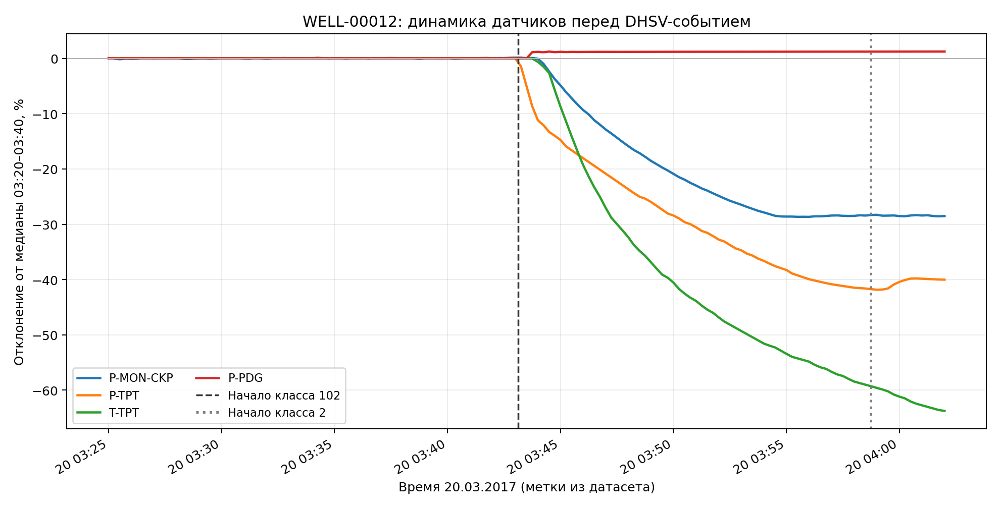
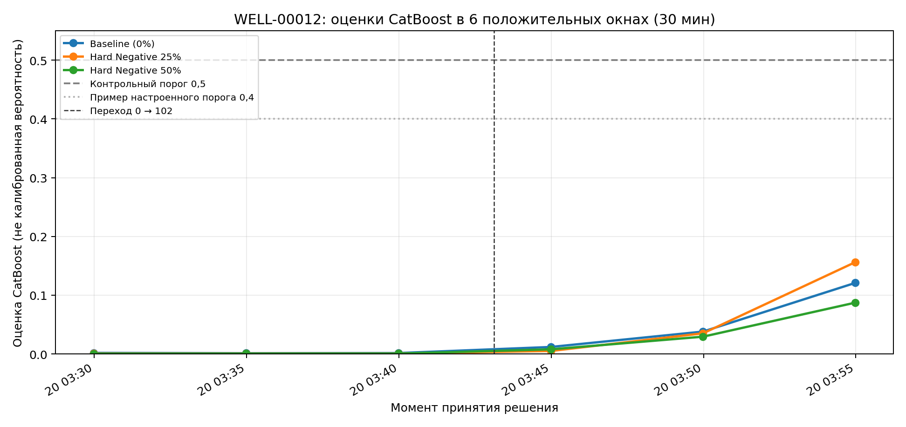

# WELL-00012 — анализ пропущенного DHSV-события

**Источник:** `WELL-00012_20170320011000.parquet` (Petrobras 3W Dataset v2.0.0), предоставлен исследователем.
**Дата анализа:** 06.11.2026.
**Статус:** исследовательский разбор отдельного эпизода; причинный механизм пропуска не доказан.

## 1. Проверка сырого файла

- Длина: **10 539** записей по 1 секунде, временных пропусков нет.
- Период: **20.03.2017 01:10:00–04:05:38** (временные метки без указанного часового пояса).
- В файле содержатся `class`, `state` и промышленные датчики; метки **не используются как признаки**.
- Метки `class` отсутствуют **в первых 3 600 секундах**, хотя четыре анализируемых датчика в эти моменты заполнены.
- `class = 0`: **02:10:00–03:43:06**, 5 587 секунд.
- `class = 102`: **03:43:07–03:58:43**, 937 секунд.
- `class = 2`: **03:58:44–04:05:38**, 415 секунд до конца файла.
- Четыре изученных датчика `P-MON-CKP`, `P-TPT`, `T-TPT`, `P-PDG` имеют по **10 539 измерений без NaN**.
- Единицы физических величин **не подтверждены** в доступных метаданных Parquet; числа представлены в исходном масштабе.

## 2. Наблюдаемая физическая динамика

Медианы разметки `0 → 102`:

| Датчик | Медиана 0 | Медиана 102 | Направление |
|---|---:|---:|---|
| `P-MON-CKP` | 10 343 850 | 8 001 728 | уменьшение |
| `P-TPT` | 19 956 130 | 13 956 850 | уменьшение |
| `T-TPT` | 115,2149 | 65,19839 | уменьшение |
| `P-PDG` | 35 201 330 | 35 622 810 | увеличение |

Медиана стабильного интервала 03:20–03:40 принята за базу для относительных изменений.
При **03:39:59** отклонения близки к нулю. На **03:54:59** относительно базы:

- `P-TPT`: **−38,09%**;
- `P-MON-CKP`: **−28,61%**;
- `T-TPT`: **−53,13%**;
- `P-PDG`: **+1,21%**.

Первые наблюдаемые изменения более чем на 1% относительно этой базы
начинаются **после** метки `class = 102`:

- `P-TPT`: **03:43:21**, +14 секунд после начала `102`;
- `P-PDG`: **03:43:50**, +43 секунды;
- `P-MON-CKP`: **03:44:23**, +76 секунд;
- `T-TPT`: **03:44:16**, +69 секунд.

Это описательная характеристика именно этой записи, а не универсальные пороги для оборудования.
Отдельно отмечаем: отсутствие выраженного изменения этих четырёх датчиков *до* `102`
не доказывает отсутствие предвестников в других переменных.

## 3. Оценки моделей: реальные архивные OOF-прогнозы

Для горизонта 30 мин модель оценивает шесть положительных моментов до начала класса 2:

| Решение | До класса 2 | Текущая размеченная фаза | Baseline (0%) | 25% HN | 50% HN |
|---|---:|---|---:|---:|---:|
| 03:29:59 | 28 мин 45 с | 0 | 0,0018 | 0,0009 | 0,0005 |
| 03:34:59 | 23 мин 45 с | 0 | 0,0013 | 0,0008 | 0,0005 |
| 03:39:59 | 18 мин 45 с | 0 | 0,0015 | 0,0008 | 0,0006 |
| 03:44:59 | 13 мин 45 с | 102 | 0,0119 | 0,0050 | 0,0079 |
| 03:49:59 | 8 мин 45 с | 102 | 0,0381 | 0,0351 | 0,0294 |
| 03:54:59 | 3 мин 45 с | 102 | 0,1210 | 0,1563 | 0,0874 |

Ни одна оценка не достигает использовавшихся порогов; у стандартного CatBoost-12
максимум **0,121**, у исследованного варианта с 25% hard negatives **0,156**,
у вложенно выбранного для WELL-00012 варианта с 50% — **0,087**.
Это **не калиброванные вероятности отказа**, а модельные оценки.

Важно: для расчёта исходных 12 признаков применяется **5-минутная история** датчиков;
15-минутная непрерывная история является требованием допуска момента диагностики
и входом многомасштабной схемы, но не длиной базовых 12 признаков.

## 4. Проверка распределений обучающих скважин

По сохранённой когорте `cohort_features.csv` (30 мин, положительные окна):

- В положительных окнах других WELL максимальное `P-MON-CKP_mean` около **5,78 млн**;
  в положительных окнах WELL-00012 — минимум **7,73 млн**.
- В положительных окнах других WELL максимальное `P-TPT_mean` около **14,48 млн**;
  для WELL-00012 в начале окна предсказания значения около **19,96 млн**,
  хотя к последнему положительному моменту они уменьшаются до **13,29 млн**.
- В положительных окнах других WELL максимальное `T-TPT_mean` около **90,1**;
  у WELL-00012 в начале прогностического интервала около **115,2**,
  хотя к последнему решению снижается до **60,6**.

**Интерпретация:** возможен сдвиг масштаба/рабочего режима относительно остальных скважин.
Изолированно этот факт **не доказывает**, что именно сдвиг стал причиной ошибочного решения CatBoost.
Нужны ablation-тесты с обучением и проверкой исключительно по удержанным скважинам.

## 5. Научные гипотезы для следующих экспериментов

1. **Поздняя наблюдаемая динамика:** до переходной фазы 102 основные четыре датчика
   почти стабильны. Поэтому первые три окна с будущей целью 1 могут не содержать
   заметных признаков надвигающегося события.
2. **Перенос между скважинами:** часть абсолютных значений положительных окон WELL-00012
   находится вне диапазонов аналогичных окон обучающих WELL. Стоит исследовать
   нормированные относительно прошлого локального уровня признаки в рамках LOOW,
   не используя будущие значения для нормировки.
3. **Отсутствующий вход:** `P-PDG` растёт в переходе, но базовый CatBoost-12 не использует
   этот сенсор. Предварительно можно проверить небольшой ablation-набор с его трендом,
   при обязательном учёте отсутствующих/нулевых показаний на других WELL.
4. **Редкий шаг диагностики:** решения каждые 5 минут; первое после начала `102` —
   только **03:44:59**. Частота решений ограничивает своевременность и требует
   отдельного исследования при сохранении корректной методики оценки.

## 6. Следующее действие

Зафиксировать анализ в `docs/` и перейти к **протоколу валидации**, а не подбирать
новый порог специально под этот единственный эпизод.

Ограничения: один файл, 11 известных DHSV-эпизодов на 7 WELL, предыдущая многократная
разработка по тем же скважинам, не калиброванные ML-оценки, нет подтверждённой внешней
оценки и измерения промышленной частоты ложных тревог.

## 7. Визуализация для повторного анализа

